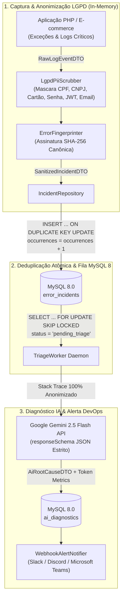

# PHP Log Sentinel 🛡️🔍

[](https://www.php.net/)
[](LICENSE)
[](https://www.gov.br/esporte/pt-br/acesso-a-informacao/lgpd)
[](https://ai.google.dev/)

Motor assíncrono em **PHP 8.2+** para **auditoria de logs, triagem inteligente de incidentes em produção e conformidade LGPD/GDPR**. O sistema intercepta exceções e logs críticos, aplica **anonimização automática de dados sensíveis (PII Scrubbing)** antes de qualquer persistência ou tráfego externo, deduplica tempestades de erros via **SHA-256 Fingerprinting** e gera diagnósticos de causa raiz com sugestão de *hotfix* utilizando a API do **Google Gemini (`gemini-2.5-flash`)** com *Structured Outputs*.

---

## 🎯 Visão Geral & Dores de Mercado Resolvidas

Equipes de engenharia que operam sistemas financeiros, SaaS e E-commerces enfrentam três riscos graves durante incidentes em produção:

1. **Violação da LGPD / GDPR em Logs de Erro (Vazamento de PII):**
   Quando uma exceção ocorre durante um checkout ou autenticação, o *stack trace* e o payload de contexto frequentemente carregam **CPFs, CNPJs, números de cartão de crédito, senhas em texto puro, e-mails e tokens JWT**. Enviar esses logs brutos para ferramentas externas de observabilidade ou APIs de LLMs configura incidente de segurança e passivo jurídico. O `LgpdPiiScrubber` varre e mascara recursivamente todos esses padrões (`[REDACTED_CPF]`, `[REDACTED_CARD]`, `[REDACTED_JWT]`, etc.) **dentro da fronteira da aplicação**.
2. **Tempestade de Alertas e Explosão de Custos de API (Alert Fatigue):**
   Se o banco de dados oscila por 2 minutos em horário de pico, o mesmo erro é disparado 10.000 vezes. Consultar uma LLM para cada linha de log custaria centenas de dólares em minutos. O `ErrorFingerprinter` gera uma assinatura determinística **SHA-256** baseada em `ExceptionClass + NormalizedFile + Line`, agrupando milhares de ocorrências em **1 único incidente** no MySQL 8 (`ON DUPLICATE KEY UPDATE occurrences = occurrences + 1`).
3. **Demora no MTTR (Mean Time To Resolution):**
   Engenheiros de plantão perdem tempo precioso cruzando *stack traces* de madrugada. O `GeminiDiagnosticProvider` analisa apenas o incidente único e anonimizado, retornando um contrato JSON estrito com **Severidade**, **Explicação da Causa Raiz**, **Arquivo/Linha Afetada** e **Patch de Código PHP Sugerido**.

---

## 🏗️ Arquitetura do Sistema



---

## 📂 Estrutura de Diretórios (PSR-4)

O projeto segue estritamente o padrão **PSR-4** sob o namespace `JzGuilherme\LogSentinel\`:

```text
php-log-sentinel/
├── bin/
│   ├── simulate-incidents.php    # Simula tempestade de erros com dados sensíveis (CPF, Cartão, JWT)
│   └── triage-worker.php         # Daemon CLI que consome incidentes inéditos com SKIP LOCKED
├── config/
│   └── database.php              # Fábrica de conexão PDO MySQL 8.0
├── database/
│   └── migrations/
│       └── 001_create_sentinel_tables.sql # Tabelas error_incidents e ai_diagnostics
├── docker/
│   ├── php/Dockerfile            # PHP 8.3-CLI com pdo_mysql, pcntl, curl, mbstring
│   └── supervisor/sentinel_worker.conf
├── src/
│   ├── Contracts/
│   │   ├── AiDiagnosticProviderInterface.php
│   │   ├── AlertNotifierInterface.php
│   │   └── PiiScrubberInterface.php
│   ├── DTO/
│   │   ├── AiRootCauseDTO.php
│   │   ├── RawLogEventDTO.php
│   │   └── SanitizedIncidentDTO.php
│   ├── Exceptions/
│   │   └── DiagnosticException.php
│   ├── Notifiers/
│   │   └── WebhookAlertNotifier.php
│   ├── Providers/
│   │   └── GeminiDiagnosticProvider.php
│   ├── Security/
│   │   ├── ErrorFingerprinter.php
│   │   └── LgpdPiiScrubber.php
│   └── Services/
│       └── IncidentTriageService.php
├── tests/
│   └── Unit/
│       ├── ErrorFingerprinterTest.php
│       ├── IncidentTriageServiceTest.php
│       └── LgpdPiiScrubberTest.php
├── .env.example
├── .gitignore
├── composer.json
├── docker-compose.yml
├── phpstan.neon
├── phpunit.xml
└── README.md
```

---

## ⚙️ Guia de Instalação e Execução

### 1. Configuração de Variáveis de Ambiente
Clone o repositório e crie seu arquivo `.env` local a partir do `.env.example`:

```bash
git clone https://github.com/JzGuilherme/php-log-sentinel.git
cd php-log-sentinel
cp .env.example .env
```

### 2. Subindo com Docker Compose
```bash
docker compose up -d --build
docker compose exec app composer install
```

### 3. Simulando Incidentes com Dados Sensíveis (LGPD Demo)
Execute o simulador para disparar eventos contendo CPFs, cartões de crédito e tokens JWT e observar a anonimização e deduplicação em ação:

```bash
php bin/simulate-incidents.php
```

### 4. Executando o Worker de Triagem com IA
```bash
php bin/triage-worker.php
```

---

## 🧪 Padrões de Qualidade e Testes

Para rodar a suíte de testes unitários (**PHPUnit 10.5**):

```bash
composer test
```

Para rodar a análise estática de tipos no nível máximo (**PHPStan Level 8**):

```bash
composer analyse
```

---

## 📄 Licença

Distribuído sob a licença **MIT**. Veja o arquivo [LICENSE](LICENSE) para mais detalhes.
